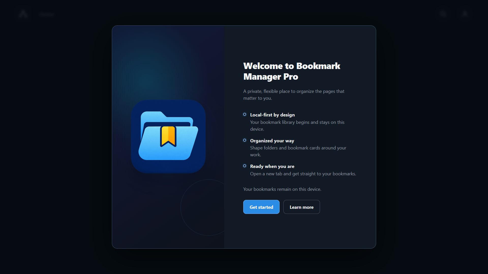
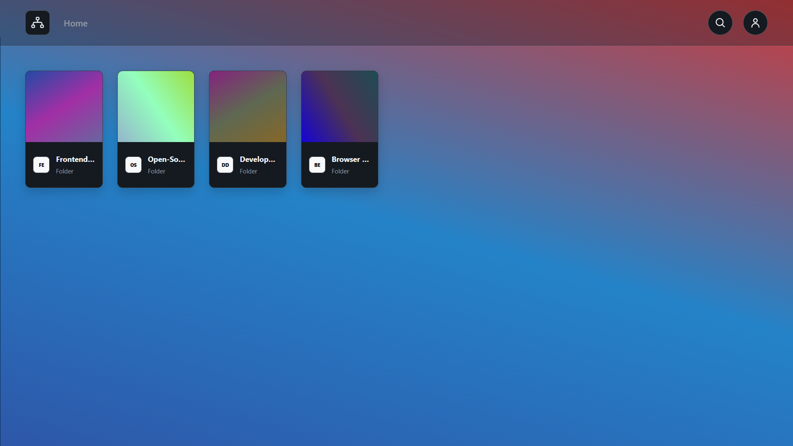
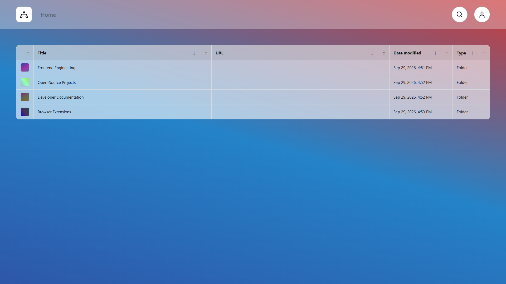

# Bookmark Manager Pro

**Find what you saved. Keep it your own.**

A useful link should be easy to find again. Bookmark Manager Pro brings visual
organization and familiar folder navigation to your browser, helping you turn
saved pages into a collection that makes sense.

Whether you save a few everyday favorites or collect references for work,
study, and personal projects, Bookmark Manager Pro gives those links a place
you can recognize, organize, and return to.

It is free, open source, and local-first, built for Chrome, Firefox, and
Microsoft Edge. No account or subscription is required.

_Explore the [screenshot gallery](screenshots/) for more views._

## Features

- **Find your way back.** Search your collection and navigate familiar folders
  instead of retracing the steps that led to a page.
- **Recognize what matters.** Visual bookmarks and customizable appearances
  make saved pages easier to distinguish at a glance.
- **Give every project its place.** Organize related links together and use
  separate local profiles for different parts of your day.
- **Make the workspace yours.** Choose a presentation that suits how you
  browse, read, and organize information.
- **Keep a copy beyond your browser.** Import and export help move saved
  information, while local recovery tools provide another way to recover work.
- **Keep your collection local.** Manage bookmarks without an online account,
  cloud storage, advertising, analytics, or third-party tracking.

For current capabilities, supported formats, and everyday instructions, see
[Help & FAQ](FAQ.md).

| Visual organization                                                     | A detailed view when it helps                                                        |
| ----------------------------------------------------------------------- | ------------------------------------------------------------------------------------ |
|  |  |

## Current status

Bookmark Manager Pro is in Alpha and under active development. The interface
and workflows continue to evolve through small, reviewed improvements.
Feedback helps shape the project as it develops. Follow the
[changelog](CHANGELOG.md) for updates and the [roadmap](ROADMAP.md) for direction.

## Get started

Visit the [installation guide](INSTALLATION.md) for browser-store links,
available packages, and manual installation instructions.

Already using the extension? [Help & FAQ](FAQ.md) explains the current
workflows and answers common questions.

## Privacy and security

Local-first storage is central to Bookmark Manager Pro. Read the
[Privacy Policy](PRIVACY_POLICY.md) for how information is handled, including
user-requested actions that take information outside extension storage.

Use the public
[issue tracker](https://github.com/YuraCodedCircuit/Bookmark-Manager-Pro/issues)
for non-sensitive questions, suggestions, and bug reports. Report suspected
vulnerabilities through
[GitHub private vulnerability reporting](https://github.com/YuraCodedCircuit/Bookmark-Manager-Pro/security/advisories/new).

## Contribute

Help improve Bookmark Manager Pro through feedback, documentation, or code.
Start with the [contribution guide](CONTRIBUTING.md) and
[Code of Conduct](CODE_OF_CONDUCT.md). Setup, requirements, and build commands
are maintained in the [development guide](DEVELOPMENT.md).

Keyboard access and accessible presentation are part of the project's design.
Current goals and known limitations are documented in the
[Accessibility Statement](ACCESSIBILITY_STATEMENT.md).

## Documentation

### Everyday use and updates

- [Help & FAQ](FAQ.md)
- [Installation](INSTALLATION.md)
- [Changelog](CHANGELOG.md)
- [Roadmap](ROADMAP.md)

### Privacy, security, and licensing

- [Privacy Policy](PRIVACY_POLICY.md)
- [Terms of Use](TERMS_OF_USE.md)
- [Disclaimer](DISCLAIMER.md)
- [Security Policy](SECURITY.md)
- [Accessibility Statement](ACCESSIBILITY_STATEMENT.md)
- [Application license](LICENSE.md)
- [Third-party licenses and notices](THIRD_PARTY_LICENSES.md)

### Development and design

- [Development guide](DEVELOPMENT.md)
- [Architecture](ARCHITECTURE.md)
- [Data and storage design](DATA_STORAGE.md)
- [Cross-browser requirements](CROSS_BROWSER.md)
- [Decision record](DECISIONS.md)
- [Logging](LOGGING.md)

## License

Bookmark Manager Pro is licensed under GNU GPLv3 only. See
[LICENSE.md](LICENSE.md) and [third-party notices](THIRD_PARTY_LICENSES.md).

Copyright (c) 2026 YuraCodedCircuit.
